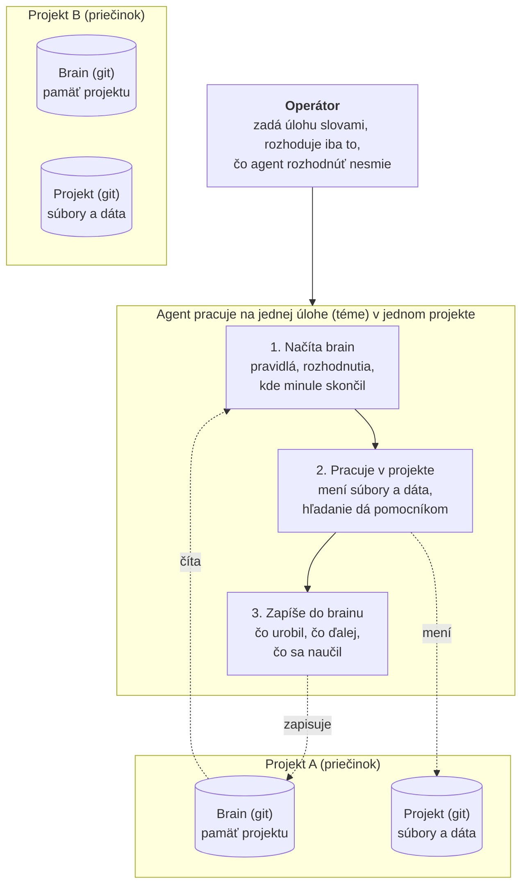
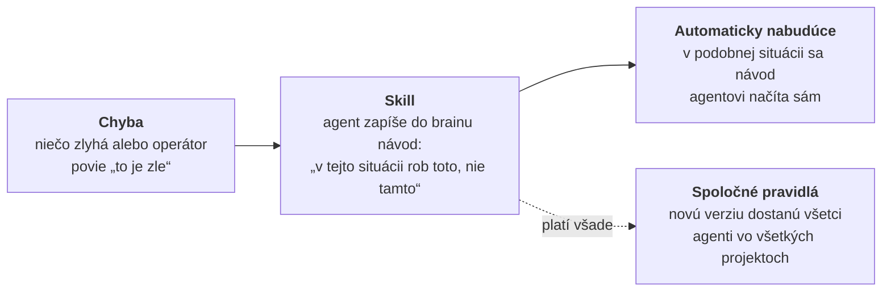

# workflow (agentic-flow)

Plugin pre Claude Code, ktorý dáva agentovi pevné pravidlá práce, základné skilly a skripty na prácu s „brain“ (pamäť, rozhodnutia, témy, handover). Jeden klon na stroji, zapína sa osobitne v každom projekte. Princípy, z ktorých workflow vychádza, sú v `docs/principles/`. Plán implementácie a nasadenia pilotu je v `PLAN.md`.

Stav: M1–M3 hotové (brain, témy, štart, stavový riadok, hooky, skilly `save`, `find`, `topic`, `done`, `error`, `delegate`, `consolidate`), M5 hotové (pošta vo workflow: stavový riadok `mail: n`, skill `comms`), M6 hotové (budenie cez T3, repo `agentic-comms`), M7 hotové (adaptér Codex; funkčnosť v Codexe overí smoke test pilotu). Pošta sama (M4) je v repe `agentic-comms`.

## Čo to je

- **Workflow** (tento repozitár) je mechanika: pravidlá, skilly, hooky, skripty. Neobsahuje nič o konkrétnom projekte ani človeku.
- **Brain** je samostatné git repo s dátami jedného projektu: pamäť, rozhodnutia, pravidlá projektu, skilly projektu, témy. Leží vedľa projektu (predvolene `../<nazov-brain>`).
- **Projekt** je tvoje repo. Workflow sa v ňom zapne dvoma malými súbormi (`.claude/settings.json`, `.workflow.json`).
- **Pošta a budenie** (správy medzi agentmi) sú samostatný repozitár `agentic-comms`; na základnú prácu nie sú potrebné. Workflow ju použije, keď ju nájde (pozri „Pošta“).

## Ako to funguje (v kocke)



- **Priečinok** je obyčajný obal a nič si nepamätá. **Git** sú súbory s celou históriou zmien a zálohou. Každý projekt je priečinok s dvoma oddelenými repami vedľa seba: brain (pamäť) a samotný projekt (súbory a dáta).
- **Pošta:** agenti si posielajú úlohy medzi sebou. **Budík:** zobudí agenta, keď má pokračovať. **Strážcovia (hooky):** kontrolujú každú odpoveď, aby agent nečakal bez budíka a nepýtal sa zbytočne.



## Predpoklady

- **git**
- **Node.js 22 alebo novší** (`node --version`). Claude Code Node neobsahuje; na Windowse ho stiahni z nodejs.org (inštalátor LTS) a reštartuj terminál.
- **Claude Code** nainštalovaný a prihlásený.
- **Windows:** Git for Windows (dodá `git`). Príkazy nižšie sú pre PowerShell.

## Inštalácia

Workflow sa klonuje presne do priečinka `skills/workflow` v nastaveniach Claude Code. Claude Code ho odtiaľ načíta ako plugin `workflow@skills-dir`. Nič iné sa globálne nemení.

**Linux**

```sh
mkdir -p ~/.claude/skills
git clone https://github.com/gavalierm/agentic-flow-public.git ~/.claude/skills/workflow
git -C ~/.claude/skills/workflow checkout "$(git -C ~/.claude/skills/workflow tag -l 'v*' --sort=-v:refname | head -1)"   # najnovšie vydanie (tag), nie branch
git -C ~/.claude/skills/workflow describe --tags            # vypíše nainštalované vydanie, napr. v0.9.14
cd ~/.claude/skills/workflow && npm test                    # voliteľné: testy workflow (bez závislostí)
```

**macOS**

```sh
mkdir -p ~/.claude/skills
git clone https://github.com/gavalierm/agentic-flow-public.git ~/.claude/skills/workflow
git -C ~/.claude/skills/workflow checkout "$(git -C ~/.claude/skills/workflow tag -l 'v*' --sort=-v:refname | head -1)"
git -C ~/.claude/skills/workflow describe --tags
```

**Windows (PowerShell)**

```powershell
New-Item -ItemType Directory -Force "$env:USERPROFILE\.claude\skills" | Out-Null
$wf = "$env:USERPROFILE\.claude\skills\workflow"
git clone https://github.com/gavalierm/agentic-flow-public.git $wf
git -C $wf checkout (git -C $wf tag -l 'v*' --sort=-v:refname | Select-Object -First 1)
git -C $wf describe --tags
```

Konkrétne vydanie: `checkout vX.Y.Z` (zoznam vydaní: `git tag -l 'v*' --sort=-v:refname`). Aby stroj dostal každé ďalšie vydanie sám, nastav v brainoch `"workflow_version": "latest"`: z priečinka projektu `node ~/.claude/skills/workflow/bin/brain.mjs pin latest --all` (pozri „Jeden brain na viacerých počítačoch“).

Overenie: v ľubovoľnom projekte spusti `claude` a napíš `/plugins`. V zozname má byť `workflow` (vypnutý). Plugin je vypnutý predvolene; zapína sa v projekte.

## Zapnutie v projekte

### Pojmy a rozloženie

| Pojem | Čo to je | Príklad |
|---|---|---|
| koreň | priečinok s poštou a projektmi; ľubovoľný, aj s medzerou v ceste | `~/agentic`, `D:\Claude projekty` |
| projekt (obal) | priečinok jedného projektu v koreni; drží repo(á) projektu a jeho brain | `<koreň>/pilot/` |
| repo projektu | git repo s kódom; jeho priečinok je projekt v T3 / Claude Code a jeho názov je **meno projektu v pošte** (adresa `<repo>/<téma>`, `--sender`) | `<koreň>/pilot/pilot-app/` |
| brain projektu | git repo s dátami workflow (pamäť, rozhodnutia, témy, skilly projektu); voliteľný (P-024) | `<koreň>/pilot/pilot-brain/` |
| persona | agent s menom; jeho repo `agent-<meno>` je zároveň brain | `agent-bob` |
| doména | priečinok persony so značkou `.agentic-domain`: hranica zápisu agentov (P-052), brain domény je brain persony | `~/agentic/Bob/` |

- Projekt s vlastným brainom bez `.agentic-domain` nie je doména: agent v ňom zapisuje do priečinka projektu, kópií jeho tém a do ciest v `domain.allow_outside` v `policy.json` brainu.
- Pomenovanie: obal `<Meno>` (doména, prvé písmeno vždy veľké; skripty ho tak založia, staršiu doménu s malým písmenom použijú, nevytvoria druhú), repo `<meno>-<časť>` (`-app`, `-web`), brain `<meno>-brain`. Repo nepomenuj rovnako ako obal (`pilot/pilot` je nečitateľné). Názov priečinka repa je meno v pošte, takže neskoršie premenovanie znamená nový kľúč pošty (pozri „Premenovanie projektu“).
- Odporúčaný spôsob: povedz agentovi „založ projekt `<meno>`“ (skill `workflow:project`, skript `bin/project.mjs`). Sprievodca založí `<koreň>/<Meno>/<meno>-<časť>` a `<koreň>/<Meno>/<meno>-brain`, súkromné repá na GitHube operátora, nastavenia projektu a projekt v T3; koreň je predvolene `~/agentic`, iný `--root <dir>`. Ten istý skript obnoví projekt na novom stroji (`restore`) a pripojí existujúce repá (`connect`). Ručný postup je nižšie.
- Persona: `persona-create.mjs <meno> [--root <dir>]` (predvolene doména `~/agentic/<Meno>`).

### Ručne

1. V koreni projektu vytvor `.claude/settings.json` (alebo doplň existujúci):

   ```json
   {
     "enabledPlugins": { "workflow@skills-dir": true },
     "autoMemoryEnabled": false
   }
   ```

2. Brain je voliteľný (P-024): projekt, ktorý spravuje persona, vlastný brain nemá (témy a pamäť sú v brain persony) a krok 2–3 vynechá. Vlastný brain iba na pokyn operátora: v koreni projektu vytvor `.workflow.json` s relatívnou cestou k brain (vždy s `/`, nikdy absolútna cesta):

   ```json
   { "brain": "../<nazov-brain>" }
   ```

   Ak brain na tomto stroji leží inde, zapíš cestu do `local/workflow.json` (rovnaký formát; `local/` je v `.gitignore`). Ten má prednosť.

3. Ak taký brain ešte neexistuje, založ ho: `node ~/.claude/skills/workflow/bin/brain-init.mjs ../<nazov-brain> --project . [--remote <adresa-repa-brain>]`. Existujúci klon brain aktivuj: `node ~/.claude/skills/workflow/bin/brain-init.mjs ../<nazov-brain> --attach --project .` (nastaví `core.hooksPath`, vytvorí `local/`).
4. Súbory commitni do projektu. Spusti `claude` v projekte; prvá odpoveď agenta má začať stavovým blokom `<projekt> / bez témy` (pozri „Prvé použitie“).

Oba súbory generuje adaptér: `node ~/.claude/skills/workflow/bin/adapter.mjs claude-code` (spusti v koreni projektu; cieľ je priečinok, v ktorom beží, alebo `--project`, nie projekt session (`CLAUDE_PROJECT_DIR`, `WORKFLOW_PROJECT_DIR`), takže persona ho môže spustiť v spravovanom projekte). Vytvorí `.claude/settings.json` (`enabledPlugins`, `permissions.deny/ask`, `autoMemoryEnabled: false`, `autoCompactWindow`), `.workflow.json` iba s `--brain ../<nazov-brain>` (bez neho projekt brain nemá), zapíše `.claude/skills/`, `local/` a `scratch/` do `.gitignore`, vytvorí `scratch/` (pracovné súbory agenta, P-052) a skopíruje skilly brain do `.claude/skills/`. Generované súbory neupravuj, ďalšie generovanie ich prepíše.

### Persona (jedno repo)

Persona je projekt, ktorého repo je zároveň brain (P-024): `.workflow.json` má `"brain": "."`. Persona nemá vlastné dáta projektu; dokumenty a výstupy idú do spravovaných projektov.

1. Nová persona: `node ~/.claude/skills/workflow/bin/persona-create.mjs <meno>` (krátke meno, napr. `bob`); skript sám odvodí repo `agent-<meno>`, overí, že neexistuje (ak existuje, skončí chybou, náhradné meno nepoužije), založí súkromné repo a brain v doméne `~/agentic/<Meno>/agent-<meno>` so značkou `.agentic-domain` (brain `agent-<meno>`). Nie ručné `brain-init` ani ručné založenie repa, lebo prefix `agent-` by sa dal obísť. Existujúce repo persony: `brain-init.mjs . --attach`.
2. V repe persony: `node ~/.claude/skills/workflow/bin/adapter.mjs claude-code --brain .`. Adaptér vygenerované súbory (`.workflow.json`, `.claude/settings.json`, `.gitignore`) sám commitne cez skript brain a pushne.
3. Agent v persone priamo zapisuje iba do `scratch/` a `local/`; všetko ostatné ide cez `save`, `topic`, `done`. Worktree persony používa brain hlavného checkoutu.

### Doména (v3)

Doména je priečinok, v ktorom agenti smú zapisovať (P-052): persona a repá, ktoré spravuje, ležia spolu; názvy priečinkov sú názvy git repozitárov.

```
~/agentic/<Doména>/        prvé písmeno veľké (Bob, Kubo); repá v nej malými písmenami
  .agentic-domain          {"brain": "agent-<meno>"}  (relatívne ku koreňu domény)
  agent-<meno>/            brain persony (.workflow.json "brain": ".")
  <repo>/                  spravované repo; vedomosť repa v <repo>/agentic/ (HANDOVER.md, decisions/, runbooks/, memory/, skills/)
  .worktrees/<repo>/<téma>/  kópie kódu kódových tém (git worktree, vetva topic/<téma>)
~/services/<repo>/         nainštalované vydanie (checkout tagu), z ktorého bežia služby; súbory sa tu nemenia, iba checkout tagu
```

Zápis mimo domény hook zamietne (nepýta sa). Výnimky má brain domény v `policy.json`: `{"domain": {"allow_outside": ["~/cesta", "/etc", "sudo"]}}` (`sudo` povolí príkaz sudo). Platí aj pre `~/services/<repo>` (nainštalované vydanie): inak sa mení iba inštaláciou tagu, ale záznam v `allow_outside` ho povolí. Značku `.agentic-domain` agent nezmení.

### Premenovanie projektu

1. Ukonči session projektu (Windows: ukonči aj nečinný `claude.exe`, ktorý T3 drží pre vlákno projektu, inak presun zlyhá).
2. Premenuj priečinok repa (aj repo na GitHube). Adaptér netreba spúšťať znova: cesta k brainu je relatívna.
3. Pošta: meno projektu je názov priečinka repa. `comms key add --sender <nové-meno>`, nový kľúč zapíš do `<brain>/local/comms.json`, starý `comms key remove --sender <staré-meno>`.
4. V T3 zmeň priečinok projektu (`workspaceRoot`) na novú cestu.

### Jeden brain na viacerých počítačoch

Každý počítač má vlastný klon brainu a stabilné meno stroja v `~/.config/agentic-flow/machine-id` (pri prvom behu z hostname, dá sa prepísať). Štart session stiahne brain z origin. Logy sa zapisujú do `logs/<stroj>/<dátum>.log` (iba pridávaním); spojený pohľad je v `local/logs/`. Pri synchronizácii sa `holder.json` vyrieši automaticky (platí origin a nový držiteľ sa overí), pri handoveri sa zachovajú obe verzie s poznámkou a `topic.json` sa zlúči po poliach. Pri ostatných súboroch skript vypíše príkaz `brain.mjs resolve <súbor> --keep local|remote`. Držiteľ témy je vlákno na konkrétnom stroji. Prechod na iný stroj: `topic.mjs handoff <téma> --task … --done … --next …`, potom na druhom stroji `topic.mjs claim <téma>`. Ak tému drží iný stroj bez aktivity dlhšie ako `topics.stale_machine_hours` (predvolene 12), claim ponúkne prevzatie po súhlase operátora. Všetky stroje drží na jednom vydaní `{"workflow_version": "v0.9.11"}` v `policy.json` brainu (od v0.9.11): štart session prepne inštaláciu vydania na tento tag. Hodnota `"latest"` (od v0.9.13) prepne pri každom štarte session na najnovšie vydanie z origin: stroj dostane každé vydanie bez úpravy pinu, nikdy vývojovú vetvu. Inštalácia je jedna pre všetky projekty na stroji: pin maj vo všetkých brainoch na stroji rovnaký. Pin nastav príkazom z priečinka projektu (od v0.9.17): `node ~/.claude/skills/workflow/bin/brain.mjs pin <vX.Y.Z|latest> [--all]`. Zapíše `workflow_version` do `policy.json` (ostatné kľúče ostanú), commitne a pushne ako ostatné zápisy brainu; `--all` to isté urobí vo všetkých brainoch, v ktorých na tomto stroji bežala session (zoznam v `~/.config/agentic-flow/pin.json`). Ručná úprava `policy.json` a `git commit` nefunguje: pre-commit brainu ju odmietne (P-040) a necommitnutá zmena blokuje sťahovanie brainu z origin. Klon sa prepne pri ďalšom štarte session (alebo `/clear`). Ak sa líšia (od v0.9.14), inštaláciu prepne iba brain, ktorý ju nastavil naposledy, alebo brain, ktorému si pin práve zmenil; ostatné ju neprepnú späť a pri štarte nahlásia `workflow not switched … set the same workflow_version in every brain on this machine`.

### Cez agenta

Spusti `claude` v koreni projektu a povedz:

> Zapni v tomto projekte workflow. (Voliteľne: Brain je `../<nazov-brain>`; ak neexistuje, založ ho.)

Agent urobí iba toto: spustí adaptér (`node ~/.claude/skills/workflow/bin/adapter.mjs claude-code`, s brain `--brain ../<nazov-brain>`), ktorý vytvorí `.claude/settings.json` (a s brain `.workflow.json`); bez pokynu brain nezakladá ani nenavrhuje; s brain, ktorý na ceste chýba, navrhne `brain-init` a počká na tvoj súhlas; nakoniec oznámi, ktoré súbory vznikli. Commit urobí až na tvoj pokyn („commitni to“). Ak Claude Code zobrazí otázku o dôvere priečinku alebo hookom, potvrď ju; bez dôvery niektoré nastavenia projektu neplatia.

Potom ukonči session a spusti `claude` znova, aby sa plugin načítal.

## Prvé použitie

- **Spustenie vlákna:** v T3 dostane vlákno ID automaticky. V termináli spusti `node ~/.claude/skills/workflow/bin/thread.mjs` (vygeneruje `WORKFLOW_THREAD_ID` a spustí `claude`; ďalšie argumenty za `--` idú harnessu, napr. `-- --resume`). Bez stabilného ID vlákno nemôže zabrať tému.
- **Pri štarte** začne prvá odpoveď agenta stavovým blokom: `<projekt> / <téma>` (pri čakajúcej pošte aj `Pošta: n`), alebo `<projekt> / bez témy`, zoznam voľných tém (`Dostupné témy:`) a otázka `Aká bude téma?`; na odpoveď čaká vlákno na teba, samo sa nebudí. Otázka padne iba vtedy, keď téma nie je známa (zadanie, ktoré tému menuje, ju nevyvolá, P-050). Agent navyše pri každom tvojom prompte dostane stavový riadok `thread <id> | topic <id> (<state>, mode <mode>) | mail: n` (pri zastavenom budení stroja navyše `| wake: off`), aj po `/clear` a `--resume`; ten vidí iba agent.
- **Hlavné vlákno persony** drží trvalú tému `main` (`topic main`, raz v hlavnom vlákne); jeho blok ukáže `<persona> / main` a počíta poštu `@<persona>/main`. **Téma pre nové vlákno:** agent založí prázdne vlákno a `topic create <id> --subject "…" --for-thread <id vlákna>`, nové vlákno tému drží od prvého ťahu.
- **Téma:** „založ tému `<id>` s predmetom …“ → agent spustí `workflow:topic` (`create`, pri kóde vznikne worktree `<doména>/.worktrees/<repo>/<id>/`, mimo domény klon `../<projekt>-topics/<id>/`). Dve vlákna nemôžu držať tú istú tému; prevzatie len na tvoj pokyn.
- **Ukladanie:** „ulož …“, „zapamätaj si …“, „volám sa …“ → `workflow:save`. Ručný zápis do brain agent nemôže (deny + pre-commit).
- **Ukončenie:** „hotovo“ → `workflow:done` (handover → voľná, téma `free`); „téma je hotová“ → `done --topic` (zlúčenie do hlavnej vetvy, archivácia).
- **Ručný zápis operátora do brain** (napr. skill v `skills/operator/`): commitni s `git commit --no-verify`; pre-commit odmieta commity mimo skriptov zámerne.

## Pošta (voliteľné)

Správy medzi témami a agentmi (`blocker`, `steer`, `assist`; `info` je zrušená, 2026-11-02) nosí samostatná služba z repa `agentic-comms`. Bez nej workflow beží bez zmeny a stavový riadok ukazuje `mail: 0`.

Zapnutie v projekte (všetky kroky mimo bežiacej session):

1. Odporúčané rozloženie: pošta je spoločná pre všetky projekty a leží **mimo nich**, každý projekt má vlastný priečinok s repom projektu a jeho brain:

   ```
   <koreň>/
     comms/                  pošta (git clone https://github.com/gavalierm/agentic-comms-public.git comms)
     projekt-a/
       <repo-projektu>/
       <brain-projektu>/
     projekt-b/
       ...
   ```

   Workflow hľadá klienta predvolene na `../../comms/bin/comms.mjs` a potom na staršom mieste `../agentic-comms/bin/comms.mjs` (relatívne k projektu); pri tomto rozložení nič ďalšie netreba nastavovať. Iné umiestnenie: do `.workflow.json` (alebo do necommitovaného `local/workflow.json`, ak platí iba pre tento stroj) doplň

   ```json
   { "brain": "../<nazov-brain>", "comms": { "client": "<klon agentic-comms>/bin/comms.mjs", "instance": "pilot" } }
   ```

   (`instance` je voliteľná; `"comms": false` poštu vypne; `"project"` prepíše názov projektu v adrese správ, predvolene názov priečinka projektu).
2. Založ inštanciu pošty a kľúč tohto projektu: `node ../agentic-comms/bin/comms.mjs init --instance pilot --sender <nazov-projektu>` (druhý a ďalší projekt: `comms key add --sender ...`). Kľúč a identifikátor inštancie zapíš do **`<brain>/local/comms.json`** (necommitovaný súbor; `local/` je v `.gitignore` brain):

   ```json
   { "instance": "pilot", "key": "<kľúč>", "instance_id": "<id z init>" }
   ```

3. Spusti session. Službu pošty netreba spúšťať ručne: klient ju pri prvom volaní spustí na pozadí (lokálny socket, bez portu). Stavový riadok ukáže `mail: <n>` pre držanú tému a odpovede tomuto vláknu; pri `n > 0` pribudne jeden riadok `mail: n waiting: <id> <kategória>` bez textu; telo správy číta hlavný agent cez `comms receive --id <id>`. Over: „aký je stav pošty?“ → agent spustí `comms.mjs status`.

Čo sa deje potom: `topic create`/`claim` zaregistruje tému v pošte (idempotentne, s držiteľom), takže iní agenti jej vedia písať na adresu `<projekt>/<téma>`. Správy pre nezaregistrovanú tému pošta pozdrží a vytvorí oznam operátorovi (`comms notices`, stránka pošty). Pri výpadku pošty hook čaká najviac 2 s, stavový riadok oznámi „comms unavailable“ raz za minútu, odchádzajúce správy čakajú v `<brain>/local/outbox/` a odošlú sa pri ďalšom úspešnom volaní. Ťah spustený správou („you have mail in topic X“) nesmie prevziať tému, uzavrieť ju ani meniť pravidlá; skripty to odmietnu.

## Codex (voliteľné)

Ten istý workflow (pravidlá, skilly, hooky, brain) beží aj v Codex CLI. Codex nemá pluginy, preto adaptér vygeneruje do projektu natívne súbory Codexu z toho istého zdroja. Codex na stroji nie je podmienkou pre Claude Code a naopak.

**Inštalácia**

1. Nainštaluj Codex CLI podľa návodu OpenAI a prihlás sa (`codex` v termináli).
2. Workflow musí byť naklonovaný ako pri Claude Code (`~/.claude/skills/workflow`, pozri „Inštalácia“); Codex používa ten istý klon a ten istý brain.

**Zapnutie v projekte** (v koreni projektu, mimo bežiacej session)

```sh
node ~/.claude/skills/workflow/bin/adapter.mjs codex
```

Vznikne:

- `.codex/config.toml` a `AGENTS.md` (commitni ich; `AGENTS.md` nesie pravidlá workflow v bloku `<!-- workflow:begin -->` … `<!-- workflow:end -->`, tvoj ostatný text v `AGENTS.md` ostáva),
- `.workflow.json`, ak chýbal (commitni),
- `.codex/hooks.json` a `.agents/skills/` (lokálne; adaptér ich zapíše do `.gitignore`, lebo obsahujú cestu ku klonu workflow na tomto stroji; `.agents/skills/` sa prepíše pri každom štarte).

Ak už `.codex/config.toml` v projekte máš a nevytvoril ho adaptér, adaptér ho odmietne prepísať: presuň jeho nastavenia do `~/.codex/config.toml` a súbor zmaž.

**Prvý štart a potvrdenia**

1. Spusti Codex v koreni projektu: `node ~/.claude/skills/workflow/bin/thread.mjs --harness codex` (dodá stabilné ID vlákna; v T3 ho dodáva T3 cez `T3CODE_THREAD_ID`).
2. Codex sa opýta, či projektu dôveruješ. **Potvrď dôveru**; bez nej Codex projektový `.codex/config.toml` ani hooky nenačíta.
3. Napíš `/hooks`. Zobrazí sa zoznam hookov workflow (SessionStart, UserPromptSubmit, PreToolUse, PostToolUse, Stop, SubagentStop); **potvrď ich (trust)**. Codex si pamätá odtlačok každého hooku, takže po aktualizácii workflow (`git pull`) ich treba potvrdiť znova; pri štarte na to upozorní.
4. Po potvrdení ukonči a spusti Codex znova. Pri štarte sa má objaviť stavový riadok `thread <id> | topic … | mail: …` a riadok `workflow <sha>`. Ak hook hlási `AGENTS.md stale`, spusti adaptér znova a commitni rozdiel.

**Rozdiely oproti Claude Code**

- Pravidlá sú v `AGENTS.md` (statické, generované), nie v hooku; po zmene pravidiel alebo výnimiek v brain treba adaptér spustiť znova.
- Codex nevie „opýtaj sa pred krokom“: krok, ktorý by v Claude Code vyžiadal potvrdenie (prepis necommitnutého súboru, `git reset --hard` …), hook v Codexe odmietne a povie, čo urobiť (commitnúť cieľ, alebo krok vykoná operátor).
- Správa `assist` alebo `blocker` bez odpovede: po uplynutí lehoty (TTL) budenie zobudí odosielateľa (P-042, P-043).
- Skilly sa volajú menom bez predpony (`save`, `topic`, …), nie `workflow:save`.

**Vypnutie v projekte:** zmaž `.codex/config.toml`, `.codex/hooks.json`, `.agents/skills/` a blok workflow v `AGENTS.md`.

## Aktualizácia

Stabilná verzia je vždy tag vydania (`vX.Y.Z`), nikdy branch:

```sh
git -C ~/.claude/skills/workflow fetch --tags
git -C ~/.claude/skills/workflow checkout v<nová-verzia>
```

Windows: to isté s `-C "$env:USERPROFILE\.claude\skills\workflow"`.

Robí sa mimo bežiacej session; zmeny platia od ďalšieho štartu. Všetky projekty na stroji, ktoré používajú stabilnú verziu, majú tú istú verziu (zámer). Nainštalované vydanie: `git -C ~/.claude/skills/workflow describe --tags` (agent ho dostane pri štarte ako riadok `workflow <sha>`). Ak `checkout` hlási lokálne zmeny, v klone niekto zapisoval; klon má byť čistý (pozri Riešenie problémov).

## Vývojová verzia (kanál dev)

Vývoj workflow beží na tom istom stroji a pod tým istým používateľom ako produkcia, bez vplyvu na ňu (P-051):

- **Repo:** `main` = stabilný stav, vydania sú tagy `vX.Y.Z`. Vývoj ide do branchu `dev`. Vydanie: merge `dev` do `main`, tag, push.
- **Stabilný kanál** (produkcia): klon `~/.claude/skills/workflow` na tagu, plugin `workflow@skills-dir`.
- **Vývojový kanál** (test): druhý klon na branchi `dev` **mimo** `~/.claude/skills/`, napr. `<koreň-pilota>/workflow`. Načíta ho premenná prostredia `CLAUDE_CODE_PLUGIN_DIRS=<absolútna cesta ku klonu>` ako plugin `workflow@inline`. Premenná musí byť v prostredí procesu, ktorý spúšťa sedenia (napr. služba T3; v termináli `export`). V `env` súboru `.claude/settings.json` nefunguje.
- **Voľba v projekte:** `node <klon>/bin/adapter.mjs claude-code --channel dev` (alebo `--channel stable`). Kanál `stable` zapíše `workflow@skills-dir: true`, `workflow@inline: false`; kanál `dev` naopak. Pregenerovanie bez `--channel` kanál ponechá. Projekt bez zápisu `workflow@inline: true` vývojový klon nenačíta, aj keď je premenná nastavená.
- **Nasadenie zmeny na test:** push do `dev`, potom `git -C <koreň-pilota>/workflow pull --ff-only`. Produkcia sa nezmení.
- Zápisy do brain kontrolujú git hooky tej verzie, ktorá zápis robí (skripty posielajú `WORKFLOW_PLUGIN_ROOT`).

## Vypnutie

- **V jednom projekte:** v `.claude/settings.json` nastav `"workflow@skills-dir": false` alebo riadok odstráň.
- **Na jedno sedenie:** `claude --settings '{"enabledPlugins":{"workflow@skills-dir":false}}'`, alebo rovnaký zápis v `.claude/settings.local.json`.

## Odinštalovanie

```sh
rm -rf ~/.claude/skills/workflow
```

Windows: `Remove-Item -Recurse -Force "$env:USERPROFILE\.claude\skills\workflow"`.

Projekty, ktoré majú workflow zapnutý, pri štarte iba oznámia chýbajúci plugin; ich dáta ani brain sa nemenia. Brain je samostatné repo, odinštalovanie workflow ho nemaže.

## Riešenie bežných problémov

| Prejav | Príčina | Riešenie |
|---|---|---|
| `/plugins` plugin `workflow` nezobrazuje | klon je v inom priečinku alebo chýba `.claude-plugin/plugin.json` | over cestu `~/.claude/skills/workflow/.claude-plugin/plugin.json` |
| plugin je v zozname, ale prvá odpoveď agenta nezačína stavovým blokom `<projekt> / …` | projekt nemá `enabledPlugins`, alebo si session nespustil v koreni projektu, alebo nie je potvrdená dôvera priečinku | over `.claude/settings.json`, spusti `claude` v koreni, potvrď dôveru |
| `node: command not found` / `'node' is not recognized` | Node nie je nainštalovaný alebo nie je v PATH | nainštaluj Node 22+, reštartuj terminál, `node --version` |
| pri štarte „brain not found“ | zlá cesta v `.workflow.json`, alebo brain na tomto stroji leží inde | oprav cestu (relatívna, s `/`), alebo doplň `local/workflow.json` |
| `git pull` hlási lokálne zmeny v klone | do klonu niekto zapisoval (nemá) | `git -C ~/.claude/skills/workflow status`; zmeny zahoď iba vedome (`git checkout -- .`), potom `pull` |
| Windows: `git pull` mení konce riadkov | chýba `core.autocrlf=false` | repo má `.gitattributes` s `eol=lf`; nastav `git config --global core.autocrlf false` |
| agent zapísal do brain priamo a commit zlyhal | pre-commit hook brain odmietol commit bez značky skriptu (zámer) | zápis do brain ide iba cez skripty workflow (`save`, `topic`, `done`) |
| stavový riadok ukazuje `thread - (no stable id …)` | session bez stabilného ID vlákna (IDE, desktop) | spusti harness cez `node ~/.claude/skills/workflow/bin/thread.mjs`, alebo pracuj bez zabratia témy |
| `topic claim` hlási `held by thread …` | tému drží iné vlákno (aj zaniknuté) | pokračuj v pôvodnom vlákne, alebo na tvoj výslovný pokyn `claim <id> --force --operator-approved` |
| pri štarte `(local changes in plugin clone, P-014)` | v klone workflow niekto zapisoval | `git -C ~/.claude/skills/workflow status`, zmeny zahoď vedome |
| brain pre-commit: `workflow plugin not found` | klon workflow nie je v `~/.claude/skills/workflow` | naklonuj ho tam, alebo nastav `WORKFLOW_PLUGIN_ROOT` |
| stavový riadok `mail: 0 (comms client not found at …)` | `comms.client` v `.workflow.json` ukazuje na neexistujúci súbor | oprav cestu (relatívne k projektu), alebo pole odstráň (predvolené `../../comms/bin/comms.mjs`, potom `../agentic-comms/bin/comms.mjs`) |
| stavový riadok `mail: ? (comms unavailable)` alebo `(neplatný kľúč)` | služba pošty nebeží a nedá sa spustiť, alebo chýba `<brain>/local/comms.json` s kľúčom | `node ../agentic-comms/bin/comms.mjs health --instance <meno>`; doplň kľúč podľa „Pošta“ |
| stavový riadok končí `| wake: off` | budenie na tomto stroji už bežalo a teraz nebeží (pošta comms od v0.4.6): zvončeky neprídu, vlákna sa samy nezobudia | `node ../agentic-comms/bin/wake.mjs status --instance <meno>`; trvalý beh `node ../agentic-comms/bin/wake.mjs install --instance <meno>` (Linux, macOS, Windows) |
| `comms send` hlási `held, operator notice` | cieľová téma nie je v pošte zaregistrovaná | adresát ju zaberie (`topic claim`), alebo operátor rozhodne v oznamoch (`redirect`/`deliver`) |
| Codex: pri štarte chýba stavový riadok | projekt nie je dôveryhodný alebo hooky nie sú potvrdené | potvrď dôveru projektu, `/hooks` → trust, reštart Codexu |
| Codex: `AGENTS.md stale` | pravidlá alebo výnimky v brain sa zmenili od posledného generovania | `node ~/.claude/skills/workflow/bin/adapter.mjs codex`, commitni `AGENTS.md` |
| Codex: adaptér hlási `config.toml … not generated by workflow` | v projekte je ručne písaný `.codex/config.toml` | presuň jeho nastavenia do `~/.codex/config.toml`, súbor zmaž, spusti adaptér znova |
